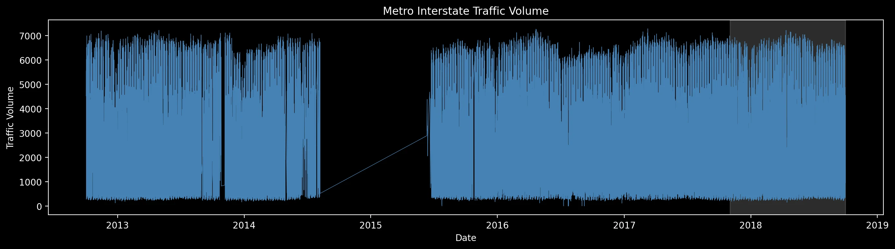

# Aikasarjadata tarvitsee ehjän aikajanan

Aikasarjaennustaminen on pohjimmiltaan menneisyyden muistelua, mutta se, miten tuo muisti syötetään mallille, riippuu siitä, millaisia valintoja teet.

Kokeilussa historiaikkunan pituudeksi valittiin 48 tuntia ja ennustehorisontiksi kolme tulevaa tuntia. Toisin sanoen malli sai syötteekseen aina kahden vuorokauden historian ja ennusti sen perusteella seuraavat kolme tuntia.

## Aikajana on osa dataa

Aikasarjat voivat olla mitä tahansa aikajärjestyksessä ja usein säännöllisin väliajoin mitattua dataa, kuten päivittäisiä markkinahintoja, tuntikohtaista sähkönkulutusta tai viikoittaista kaupan myyntiä. Aikasarjoja on siis kaikkialla, oli kyse sitten hitaista luonnonilmiöistä tai pörssikurssien vilkkaista heilahteluista. [^deep]

Koska aikasarjadata on kuin kronologinen tarina, se vaatii hieman erilaista rakkautta: eri lähteiden kellot on tahdistettava, poikkeamia on ymmärrettävä suhteessa aikaan ja datan sisäinen rytmi on tuotava näkyviin. [^trid] Näin aikasarjan ajallinen rakenne säilyy myös mallin näkökulmasta.

## Puuttuva havainto ei aina näy tyhjänä soluna

Tavallisessa taulukossa puuttuva tieto on helppo löytää tyhjänä soluna, mutta aikasarjat ovat salakavalampia. Ongelma ei välttämättä ole tyhjä arvo, vaan puuttuva rivi tai saman ajanhetken duplikaatti. [^sour]

Tämä haaste tuli vastaan myös kokeilussa: aikajana ei ollut täysin eheä, joten data täytyi ensin ”pakottaa” takaisin tiukkaan tuntikohtaiseen rytmiin käyttämällä Pandasin `asfreq`-metodia. Vasta tämän jälkeen puuttuvat kohdat paljastuivat oikeina `NaN`-arvoina, jolloin niitä pystyttiin käsittelemään.

Kun dataa tarkasteli koko aikajanan tasolla, ongelma tuli näkyviin selvinä katkoksina:

{ .evidence-image }

*Puuttuvat havainnot eivät ilmene vain yksittäisinä NaN-arvoina, vaan myös katkoksina aikajanassa. Tällaiset aukot rikkovat aikasarjan jatkuvuutta ja ne on huomioitava ennen ikkunointia ja mallin koulutusta.*

## Ajan suuntaa ei saa rikkoa

Aikasarjojen kanssa ei voi pelata samoilla säännöillä kuin tavallisen datan kanssa. Nyt emme voi heittää hommaa tehosekoittimeen ja vain arpoa rivejä eri pinoihin. Jos sekoittaisimme datan ennen jakoa, malli pääsisi ”kurkkimaan” tulevaisuuteen. Tätä kutsutaan **data leakageksi** eli tietovuodoksi: malli ei ennusta tulevaa, vaan se muistaa asioita, joita se on nähnyt historian seassa. [^apx]

Käytännössä siis otamme vanhimman osan datasta koulutukseen ja tuoreimman osan testaukseen. [^sour] Näin testi vastaa paremmin aitoa ennustetilannetta, jossa malli joutuu todelliseen tulikokeeseen arvioidessaan jotain sellaista, mitä se ei ole koskaan nähnyt. Kokeilussa jako tehtiin aikajärjestyksessä näin:

```python title="Aikajärjestyksessä tehty jako"
TRAIN_SIZE = 0.8
train_index = int(len(df_engineered) * TRAIN_SIZE)

train_df = df_engineered.iloc[:train_index]
test_df = df_engineered.iloc[train_index:]
```

## Missä muodossa historia annetaan mallille?

Kun datan ajallinen rakenne on huomioitu, seuraava olennainen kysymys onkin, missä muodossa mennyt historia esitetään mallille.

Perinteisille koneoppimismalleille historia täytyy usein askarrella käsin valmiiksi viivepiirteiksi eli **lag-piirteiksi**, joissa aiemmat havainnot tuodaan näkyviin omiksi sarakkeikseen. Malli siis saa tietyt faktat, kuten eilisen myynnin tai viime viikon sään, ja oppii näiden yksittäisten vihjeiden perusteella. [^sour]

Neuroverkot taas ovat tässä omatoimisempia, sillä ne kykenevät käsittelemään koko tarinan kerrallaan, jolloin niille voi syöttää koko aikaikkunan sekvenssinä. Tällöin esimerkiksi 48 tunnin historia annetaan mallille yhtenä syötejaksona, ja malli saa itse hiffata tuon ”filminauhan” perusteella, mitkä hetket menneisyydestä ovat tärkeimpiä ennusteen kannalta. [^sour]

No saako opetusdataa ikinä sekoittaa (`shuffle`)? Kyllä saa, kunhan se tehdään vasta jaon jälkeen. Kun data on jo pilkottu erillisiksi aikaikkunoiksi ja aikajärjestys on lukittu kunkin ikkunan sisään, näitä ikkunoita voidaan syöttää mallille sekoitetussa järjestyksessä ilman, että niiden sisäinen aikajärjestys rikkoutuu. [^sour]

---

!!! note "Kirjoituksen tausta"
    Kirjoitus on toimitettu Syväoppiminen I -oppimispäiväkirjani aikasarjamerkinnästä. Koodikatkelma on samassa merkinnässä käytetty, kommenttien osalta lyhennetty ote kurssin Metro Interstate Traffic Volume -notebookista. Kurssimateriaali: Jani Sourander. [^sour]

## Lähteet

[^deep]: François Chollet & Matthew Watson. [Deep Learning with Python](https://deeplearningwithpython.io/). Manning. 2025
[^trid]: Edward Baumann, Hayley Buba, Taylor Cox and Charles Hsu. [An Introductory Approach to Time-Series Data Preparation and Analysis](https://www.researchgate.net/publication/375200886_An_Introductory_Approach_to_Time-Series_Data_Preparation_and_Analysis). Trident Systems Inc. 2023
[^sour]: Jani Sourander. [Syväoppiminen I -verkkomateriaali](https://sourander.github.io/syvaoppiminen/)
[^apx]: ApX Machine Learning. [Time Series Analysis and Forecasting](https://apxml.com/courses/time-series-analysis-forecasting). 2026
