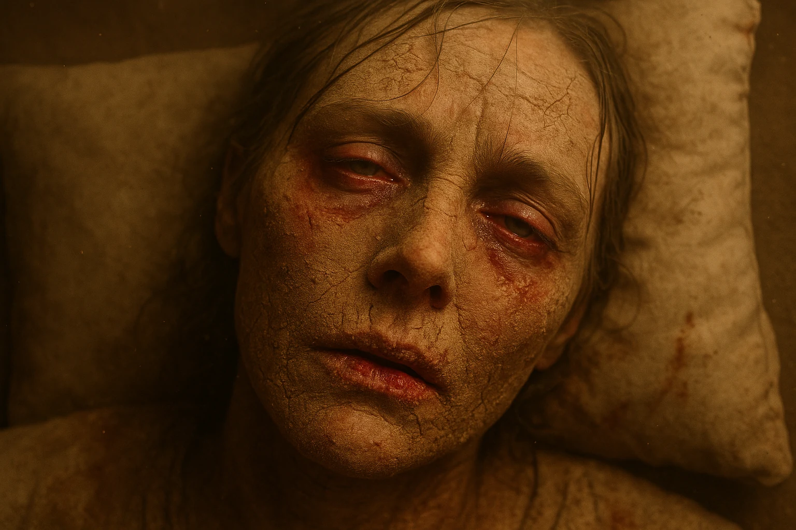
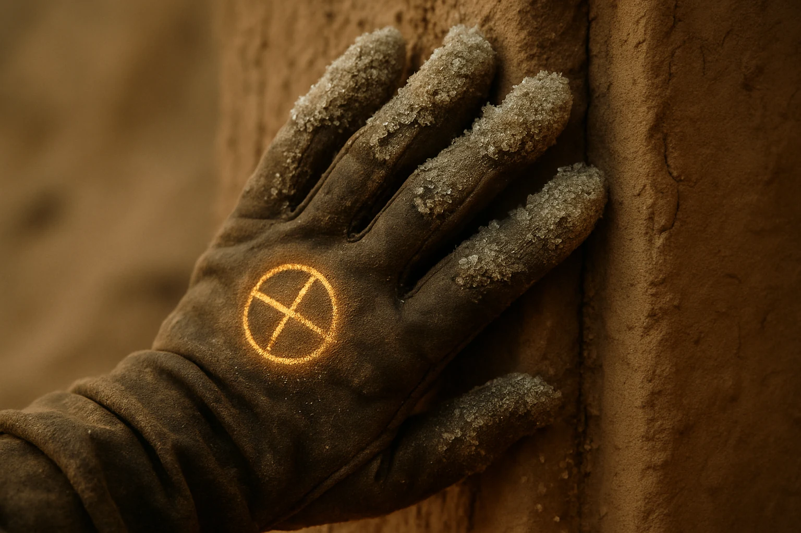
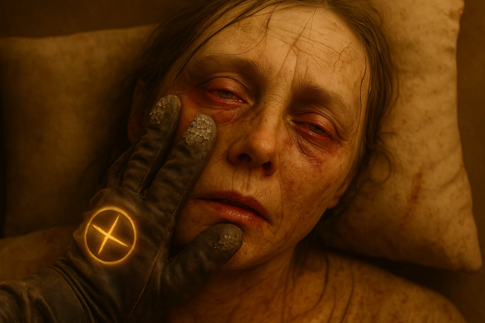
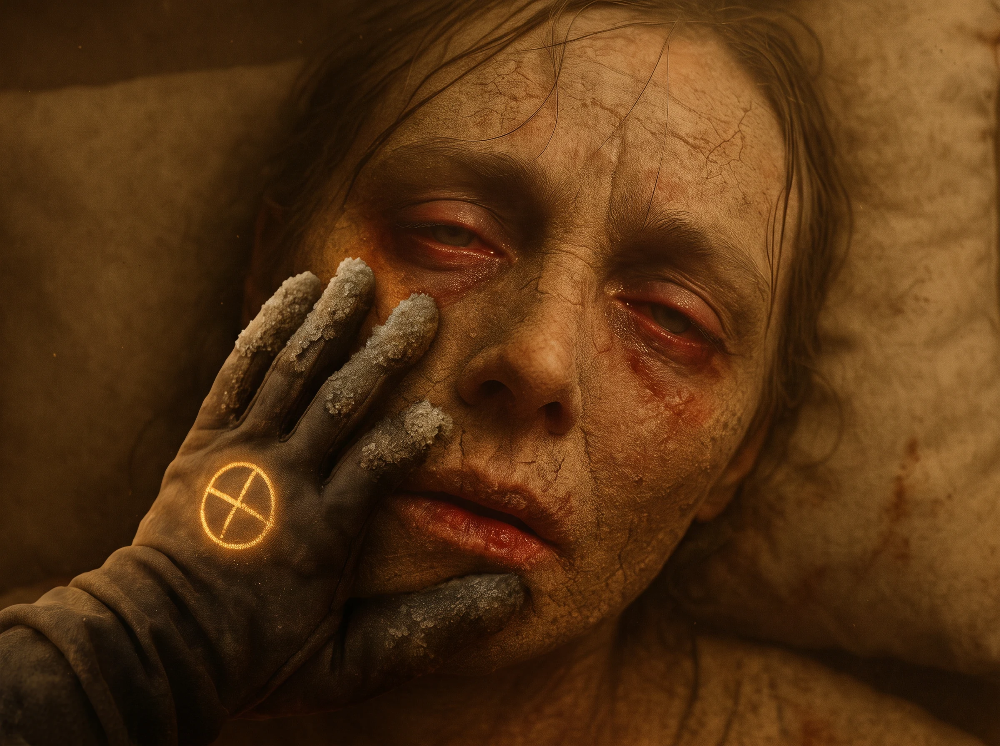
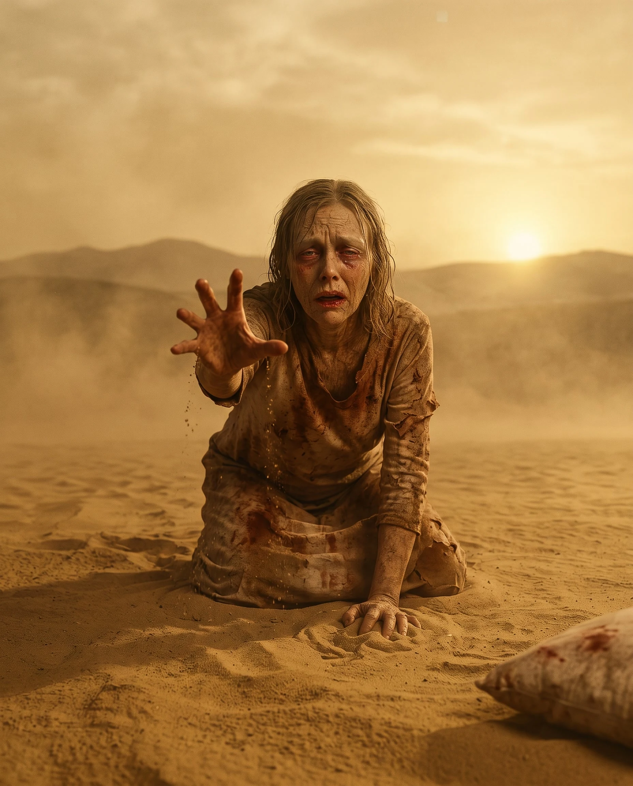
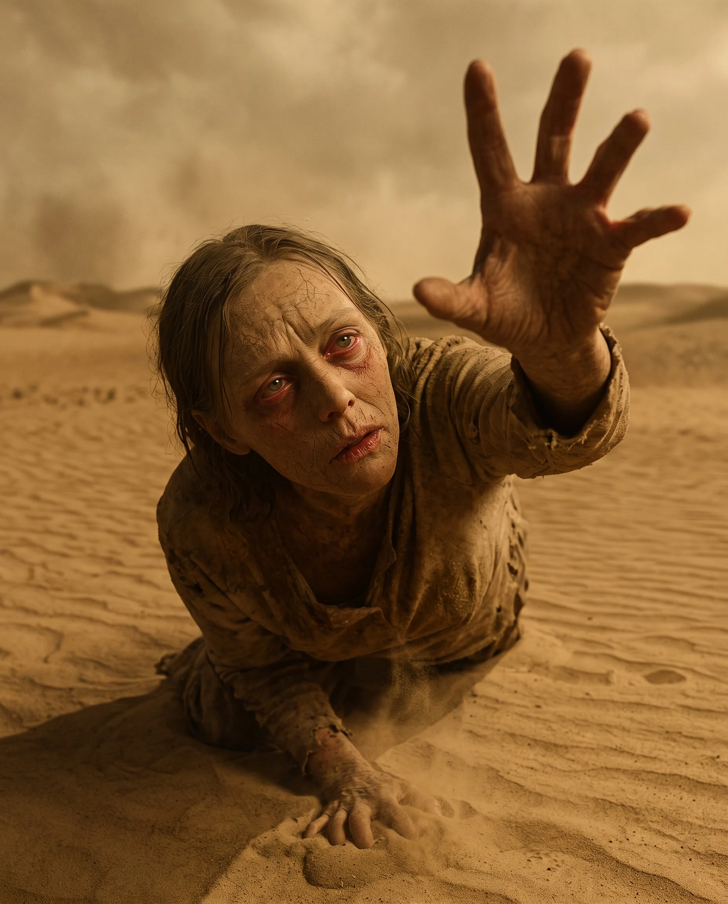

---
title: "Kun malli vaihtuu: hahmon jatkuvuus generatiivisessa kuvassa"
description: Vertailu Hesh’thar-kokeilun ja Nano Banana 2 -työskentelyn välillä.
---

# Kun malli vaihtuu: hahmon jatkuvuus generatiivisessa kuvassa

Kun tein Hesh’thar-kokeilun loppuvuonna 2025, halusin selvittää, miten AI-generoidussa videossa voisi säilyttää saman hahmon eri kohtauksissa. Hahmo ei puhu, joten tarinan piti välittyä ympäristöstä, liikkeestä, tunnelmasta ja visuaalisesta jatkuvuudesta.

Nyt katson samaa kokeilua hieman eri näkökulmasta. Kuvamallit ovat kehittyneet nopeasti, ja esimerkiksi Nano Banana -malliperheen image-to-image-työskentelyssä samaa hahmoa voidaan käyttää eri kuvien lähtökohtana. Siksi kiinnostava kysymys ei ole enää vain se, miten hahmon saa pysymään samana, vaan myös se, miten mallin kehitys muuttaa omaa työskentelytapaa.

!!! abstract "Ydinhavainnot"
    Kirjoituksessa vertaan Hesh’thar-videon alkuperäistä työskentelytapaa Nano Banana 2 -mallilla tekemiini kuvakokeisiin. Tarkastelen, miten hahmon kasvot, hansikas ja visuaalinen jatkuvuus säilyivät sekä millaisia uusia virheitä malli toi kuviin.

!!! note "Hesh’thar-video"
    Videosta näkee alkuperäisen hahmon, visuaalisen maailman ja sen, millaista jatkuvuutta yritin rakentaa videokohtauksien välille.

    <iframe width="560" height="315" src="https://www.youtube.com/embed/WyRTJZa4cDQ" title="Hesh’thar-kokeilu" frameborder="0" allow="accelerometer; autoplay; clipboard-write; encrypted-media; gyroscope; picture-in-picture; web-share" allowfullscreen></iframe>

## Hesh’thar: jatkuvuutta rajoitteiden avulla

Hesh’thar sijoittuu postapokalyptiseen aavikkomaisemaan. Tavoitteena oli rakentaa lyhyt generatiivinen video, jossa hahmon identiteetti säilyisi kohtauksesta toiseen ja jossa tunnelma syntyisi ilman runsasta dialogia tai selittävää juonta.

Yritin vakioida hahmoa pitämällä sen keskeiset kuvaukset samoina ja käyttämällä referenssikuvaa uudelleen. Sora Remix -toiminto auttoi palaamaan alkuperäisen hahmon piirteisiin, kun kohtaukseen lisättiin uusi ympäristö tai tilanne. Videokohtauksissa kokeilin Klingin eri malliversioita sekä alku- ja loppukuvien hyödyntämistä, jotta erilliset generoinnit olisi mahdollista yhdistää toisiinsa.

Työskentely ei ollut täysin suoraviivaista. Hahmon identiteetti pysyi paremmin koossa, kun alkuperäinen referenssikuva kulki mukana, mutta ympäristöön, valaistukseen ja värimaailmaan liittyi silti vaihtelua. Ja hahmon jatkuvuuden ylläpitäminen ei ollut kärsimättömän hommaa, vaan se vaati useita generointeja ja kokeiluja. 

{ .evidence-image }

*Hesh’thar-kokeilun kasvoreferenssi. Kasvojen ilme, ihon halkeamat, silmien muoto ja lämmin ruskea värimaailma toimivat hahmon visuaalisina ankkureina.*

{ .evidence-image }

*Hesh’thar-kokeilun käsinereferenssi. Käsineen materiaali, huurre ja hehkuva symboli ovat yksityiskohtia, jotka halusin siirtää myöhempään yhdistelmäkuvaan.*

Kasvokuva toimi naisen ja hänen kasvojensa pääreferenssinä. Hansikaskuva taas toi mukaan käsineen materiaalin, huurteen ja hohtavan symbolin. Näiden kahden kuvan avulla pystyin tarkastelemaan, miten malli yhdistää kaksi erilaista visuaalista kokonaisuutta samaan kuvaan.

Kokeilun tärkein havainto oli, että jatkuvuutta piti silloin rakentaa usean rajoitteen avulla. Referenssikuva, kiinteät hahmokuvaukset, rajattu väripaletti ja alku- sekä loppukuvat tukivat toisiaan. Samalla jokainen uusi kohtaus saattoi muuttaa jotakin sellaista, jota en ollut pyytänyt muuttamaan.

## Alkuperäinen yhdistelmä ei säilyttänyt kaikkea

Seuraavaksi yhdistin kasvot ja käsineen samaan kuvaan. Ensimmäinen yhdistelmä oli tunnelmaltaan lähellä tavoitetta, mutta siinä molemmat referenssit muuttuivat. Kasvot näyttivät erilaisilta kuin alkuperäisessä kasvokuvassa: hiekka hävisi kasvoilta, jonka vuoksi ihon sävy ja kuvan tunnelma muuttuivat paljon. Myös käsineen symboli ei ole identtinen, huurteen määrä väheni ja yksityiskohtia katosi hanskasta yhdistämisen aikana.

{ .evidence-image }

*Ensimmäinen yhdistelmä. Kuva on visuaalisesti yhtenäinen, mutta se ei säilytä kasvojen ja käsineen yksityiskohtia riittävän tarkasti.*

Nähtävissä on myös, että värimaailma muuttui huomattavasti punaisemmaksi ja se poisti paljon tärkeitä yksityiskohtia, kuten hiekan tuoman peitteen naisen iholta. 

## Mitä Nano Banana muuttaa?

Tässä vertailussa käytin Nano Banana 2 -kuvamallia. Se tuo samaan ongelmaan erilaisen lähtökohdan: image-to-image-muokkauksessa olemassa oleva hahmo voidaan antaa uuden kuvan referenssiksi ja ympäristöä tai tilannetta muuttaa sen ympärillä. Googlen omassa kuvauksessa Nano Banana 2 on tarkoitettu myös useiden referenssikuvien käsittelyyn ja hahmon jatkuvuuden säilyttämiseen. [^googleai]

Tämä muuttaa työskentelyn painopistettä. Hesh’tharissa yritin ohjata mallia säilyttämään hahmon tekstin, referenssikuvan ja useiden videotyökalujen avulla. Nano Bananalla voisin aloittaa jo toimivasta kuvasta ja pyytää mallia muuttamaan esimerkiksi paikkaa, asentoa, vaatetusta tai valaistusta. Malli ei silti tee vertailua puolestani: minun täytyy edelleen päättää, mikä kuvassa saa muuttua ja mikä ei.

### Image-to-image-flow tässä kokeilussa

Työskentely eteni tässä kokeilussa seuraavasti:

1. Alkuperäinen kasvokuva toimi referenssinä.
2. Pyysin Nano Banana 2:ta sijoittamaan saman naisen uuteen aavikkokohtaukseen. En antanut taustakuvaa, vaan annoin mallille vain tekstimuotoisen kuvauksen.
3. Erillisessä yhdistelmäkokeilussa annoin mallille sekä naisen kasvokuvan että hansikkaan kuvan.
4. Ensimmäisten vedosten tavoitteena ei ollut täydellisyys, vaan realistinen lähtökohta ja havainto siitä, mitä malli tekee ensimmäisellä yrityksellä.
5. Tämän jälkeen tarkastelin, mitä pitäisi seuraavalla promptilla korjata.

Ensimmäiset vedokset ovat tässä hyödyllisiä juuri siksi, että mallin toimintaa ei aina pysty ennakoimaan. Esimerkiksi tyynyn siirtymistä mukaan ei välttämättä tule ajatelleeksi ennen kuin sen näkee lopputuloksessa. Kokeilu auttaa ymmärtämään, mitä mallille pitää sanoa seuraavalla kierroksella.

### Kaksi Nano Banana -koetta

Nano Banana -kokeilu ei ollut yksi pitkä kuvanmuokkausketju, vaan kaksi erillistä testiä. Ensimmäisessä yhdistin naisen kasvokuvan ja hansikaskuvan. Toisessa käytin vain alkuperäistä kasvokuvaa ja sijoitin naisen uuteen ympäristöön tekstipromptilla.

| Kokeilu | Lähtökohta | Mitä muutin | Mitä arvioin |
|---|---|---|---|
| Kasvojen ja hansikkaan yhdistelmä | Naisen kasvokuva ja erillinen hansikaskuva | Yhdistin kaksi referenssikuvaa samaan lähikuvaan | Kasvojen tunnistettavuus, hansikkaan mittakaava, materiaali, symboli ja värilämpötila |
| Nainen uudessa ympäristössä | Alkuperäinen kasvokuva; ei taustakuvaa | Sijoitin naisen autiomaahiekkaan tekstipromptilla | Kasvojen säilyminen, uuden asennon uskottavuus ja se, siirtyykö mukaan pyytämättömiä objekteja |

{ .evidence-image }

*Nano Banana 2:lla tehty parannettu yhdistelmä. Kasvojen pääreferenssinä käytettiin naisen kasvokuvaa ja hansikkaan pääreferenssinä erillistä hansikaskuvaa.*

Kasvot säilyivät alkuperäiseen kuvaan verrattuna paljon paremmin ja olivat helpommin tunnistettavat. Hansikas pieneni alkuperäiseen kuvaan verrattuna ja sen koko vaikuttaa enemmän lapsen, kuin aikuisen kädeltä. Joka tekee kuvaan oudot mittasuhteet. 

Hansikkaan pinta piti paljon enemmän yksityiskohtia ja hohtava symbolikin muistutti enemmän alkuperäistä kuvaa. Hauskasti hansikkaan päässä oleva huurre levisi osittain naisen kasvoille. Malli näyttää yrittäneen sulauttaa kuvia yhteen, mutta lopputulos synnytti samalla uuden yksityiskohdan, jota en pyytänyt.

Kuvasta silti katosi yksityiskohtia, jos kuvia vertaa tarkasti ja värisävy kuvassa muuttui aavistuksen. En voi päätellä varmasti, johtuuko ero hansikkaan referenssikuvan valaistuksesta vai itse generoinnista, mutta seuraavassa vaiheessa lähtisin sovittamaan hansikkaan kokoa, varjoja ja värilämpötilaa naisen kuvaan.

### Seuraava korjaus: hansikkaan sulauttaminen

Tässä yhdistelmäkokeilussa seuraava korjaus voisi kohdistua vain hansikkaaseen. Pyytäisin mallia säilyttämään hansikkaan materiaalin ja symbolin, mutta sovittamaan sen värilämpötilan, valon, varjot, perspektiivin ja terävyyden paremmin naisen kuvaan. Esimerkiksi näin:

>Preserve the woman's warm color palette and lighting. Integrate the glove naturally into the same scene by matching its color temperature, shadows, highlights, texture, perspective, and depth of field. Keep the glove's material and symbol. Preserve the woman's face and expression.

### Sama hahmo uudessa kohtauksessa

Kokeilin seuraavaksi, miltä sama nainen näyttäisi kokonaan uudessa ympäristössä. Annoin mallille alkuperäisen kasvokuvan ja pyysin sitä lisäämään naisen kyykkyyn autiomaahiekkaan. Promptissa korostin, että kasvojen hienovaraiset piirteet, väripaletti ja naisen kasvot säilyvät muuttumattomina.

Tämä on lähempänä sellaista image-to-image-työskentelyä, jota olisin voinut käyttää Hesh’thar-kokeilussa: onnistunut hahmokuva olisi toiminut seuraavan kohtauksen lähtökohtana, ja muutos olisi kohdistunut ensisijaisesti ympäristöön sekä asentoon.

Käyttämäni prompti oli:

>Add the same woman crouching in the desert sand; her face is clearly visible and shows signs of anguish. It appears she is trying to reach for something, but grasping only at the air. Keep the subtle features, color palette, and the woman's face completely unchanged.

Tässä aavikkokokeilussa käytin Nano Banana 2 -mallia ja alkuperäistä kasvokuvaa ainoana referenssinä. Taustakuvaa en antanut.

{ .evidence-image }

*Ensimmäinen uusi kohtaus. Malli säilytti kasvojen lisäksi paljon alkuperäisen kuvan tunnelmaa. Kuvassa näkyy myös tyyny, joka näyttää siirtyneen mukaan kasvoreferenssistä, vaikka sitä ei pyydetty autiomaahan.*

{ .evidence-image }

*Toinen uusi kohtaus. Tiiviimpi kuvakulma korostaa naisen elettä ja katsetta, mutta samalla muuttuvat sommittelu, käden mittasuhteet ja kasvojen ilme enemmän.*

Kasvot säilyivät alkuperäiseen kuvaan verrattuna paljon paremmin ja olivat helpommin tunnistettavat. Täydellinen identtisyys ei kuitenkaan ole realistinen tavoite: myös ihmisen ulkonäkö vaihtelee ilmeen, silmien tummuuden ja kuvakulman mukaan. Tässä kokeilussa tärkeämpää oli, että hahmo säilyi tunnistettavana.

Tyyny ei ole yksiselitteisesti virhe. Se kertoo, että malli tunnisti alkuperäisessä kuvassa olevan objektin ja pyrki säilyttämään sen mukana. Toisaalta tyynyä ei pyydetty aavikkokohtaukseen, joten seuraavassa promptissa pitäisi sanoa selvästi, että mukaan otetaan vain nainen eikä muita alkuperäisen kuvan objekteja.

### Seuraava korjaus: vain nainen uuteen ympäristöön

Seuraava korjaus kohdistuisi siihen, ettei alkuperäisestä kasvokuvasta siirtyisi mukaan tyynyä tai muita objekteja. Esimerkiksi näin:

>Keep only the woman from the reference image. Do not include the pillow or any other objects from the original image. Place the same woman crouching in the desert sand, with her face clearly visible and showing anguish. Preserve her facial features, expression, and the warm color palette while changing only the environment and pose.

Tässä tapauksessa promptissa olisi pitänyt sanoa suoraan: ota mukaan vain nainen, älä alkuperäisen kuvan muita objekteja. Tämä onkin täysin erilainen korjaus kuin hansikkaan sulauttaminen osaksi naisen kuvaa, koska aavikkokuvassa käytettiin vain naisen kasvoreferenssiä.

## Mallin kehitys ei poista arvioinnin tarvetta

Nano Banana tekee hahmon jatkuvuuden tavoittelusta helpompaa, mutta se ei poista kokeilun suunnittelua. Jos sama hahmo säilyy kuvasta toiseen, täytyy silti arvioida, mitä ympäristön vaihto muuttaa, katoavatko pienet yksityiskohdat ja siirtyykö mukaan jotakin, mitä ei pyydetty.

Tämän tarkoitus ei ollut todistaa että yksi malli on kaikissa tilanteissa parempi kuin toinen. Vaan halu ymmärtää, millaisessa tehtävässä kumpikin työskentelytapa toimii ja millaisia virheitä niihin liittyy.

## Mitä kokeilu kertoo generatiivisesta AI:sta?

Hesh’tharissa jatkuvuutta piti rakentaa usean rajoitteen avulla. Image-to-image-työskentelyssä osa tästä työstä siirtyy mallille, mutta oma roolini ei katoa. Minun täytyy edelleen määritellä, mikä saa muuttua, mitä pitää säilyttää ja miten tulosta arvioidaan.

Jälkikäteen ajatellen saman hahmon rakentaminen olisi nykyisillä työkaluilla helpompaa. Kokeilu opetti silti, että image-to-image ei tarkoita automaattisesti valmista lopputulosta. Promptin täytyy olla täsmällinen: esimerkiksi, kertoa että mukaan otetaan vain nainen eikä muita objekteja. Ensimmäiset vedokset ovat hyödyllisiä, koska niiden avulla huomaa, mitä mallin toiminnasta ei osannut ennakoida ja mitä seuraavalla kierroksella täytyy ohjata tarkemmin.

!!! note "Kokeilun tausta"
    Hesh’thar on joulukuussa 2025 tehty generatiivisen videon kokeilu. Alkuperäisessä työssä käytin Soraa, Klingiä, Sunoa, ElevenLabsia ja DaVinci Resolvea. Nano Banana 2 -osuus on tähän kirjoitukseen myöhemmin tehty vertailu, jossa samaa hahmoa testataan kuvanmuokkauksen lähtökohtana.

## Lähteet

[^googleai]: Google AI for Developers. [Nano Banana image generation](https://ai.google.dev/gemini-api/docs/image-generation). 
