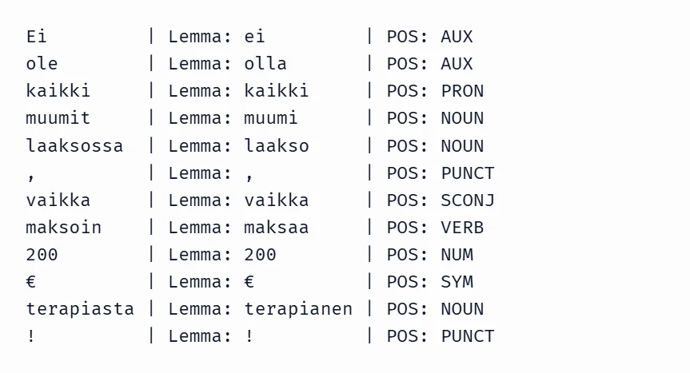
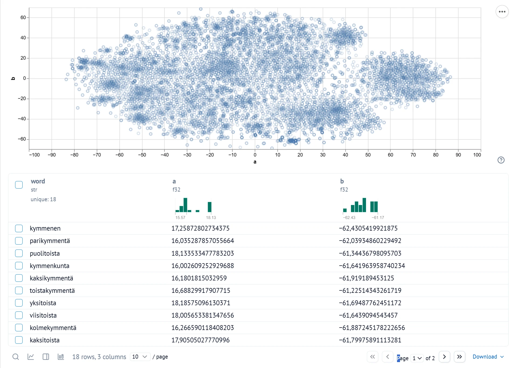
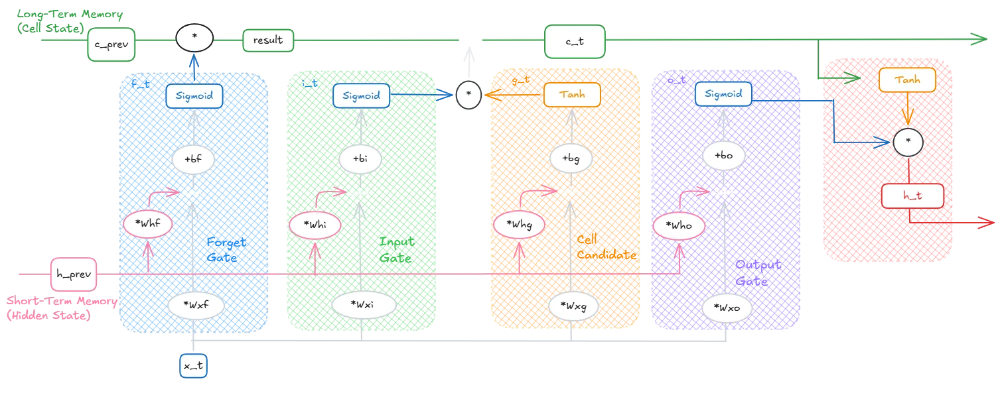
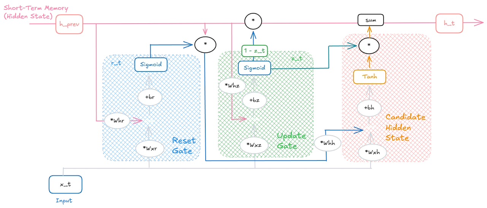
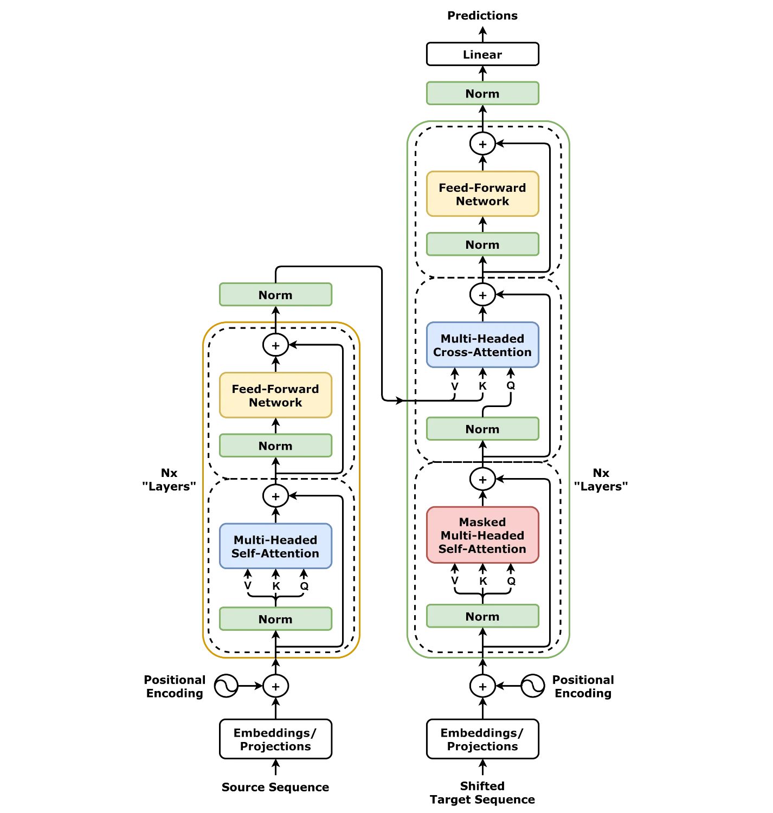

# Sanoista numeroiksi – miten konteksti kulkee mukana?

Kieli on luultavasti yksi ihmisyyden monimutkaisimmista ilmiöistä. Toisin kuin ohjelmointikielet, jotka on rakennettu tiukkojen sääntöjen varaan, luonnollinen kieli on syntynyt käytön kautta, orgaanisesti ja sääntöjä uhmaten. [^sour]

Suomalainen klassikkoesimerkki ”Kuusi palaa” havainnollistaa hyvin kielen monitulkintaisuutta: on lähes mahdoton tietää, onko kyseessä numero, puu, palava objekti vai kenties jokin palasiksi mennyt. Miten tietokone voisi ymmärtää oikean kontekstin ja merkityksen, kun se tuottaa päänvaivaa ihmisellekin?

!!! abstract "Ydinhavainnot"
    Kirjoituksessa seuraan, miten kielen käsittely etenee rakenteen tunnistamisesta sanavektoreihin, rekurrentteihin malleihin ja transformereihin. Omissa kokeiluissani sujuvaltakin näyttävä tulos saattoi sisältää virheitä, jotka muuttivat alkuperäisen lauseen merkityksen.

## Kielen jäsentäminen ei vielä tarkoita ymmärtämistä

Esikäsittely voidaan hoitaa kirjastoilla, kuten SpaCylla. Ensimmäinen vaihe on yleensä tokenisointi, jossa teksti pilkotaan pienempiin yksiköihin eli tokeneihin, kuten sanoiksi tai välimerkeiksi. Tämän jälkeen tekstistä voidaan tunnistaa esimerkiksi sanaluokkia, perusmuotoja ja lauserakenteita. Tämä ei kuitenkaan vielä tarkoita merkityksen ymmärtämistä, vaan ennen kaikkea kielen rakenteen jäsentämistä. [^sour] [^deep]

Testasin SpaCyn suomenkielistä `fi_core_news_sm`-mallia nähdäkseni, miten se käsittelee monitulkintaista kieltä. Vaikka malli on tilastollinen, se pyrkii niin sanotusti ”kesyttämään” tekstin tunnistamalla sen perusrakenteita:

```python title="Sanaluokat ja perusmuodot"
import spacy

nlp = spacy.load("fi_core_news_sm")
doc = nlp("Ei ole kaikki muumit laaksossa, vaikka maksoin 200€ terapiasta!")

for token in doc:
    print(f"{token.text:<10} | Lemma: {token.lemma_:<10} | POS: {token.pos_}")
```

{ .evidence-image }

*Kuvakaappaus samasta kokeilusta. Malli tunnistaa lauseesta tokenit, perusmuodot ja sanaluokat, mutta esimerkiksi sanan ”terapiasta” lemmaksi päätyy kuvassa virheellisesti ”terapianen”. Oma tulkintani on, että malli vaikuttaisi vetävän hieman mutkia suoriksi ja soveltaa suomen kielen kaavaa, jossa **-sta**-loppuinen taivutusmuoto liittyy **-nen**-loppuiseen perusmuotoon (esimerkiksi ”punaisesta” → ”punainen” ja ”naisesta” → ”nainen”).*

Esimerkki osoittaakin, että kielen esikäsittely ei vielä tarkoita merkityksen ymmärtämistä. Malli näyttäisi tekevän tässä tilastollisen arvauksen, joka voisi olla rakenteellisesti mahdollinen, vaikka muutoin kuulostaakin absurdilta. Rakenteen tunnistaminen ja todellisen merkityksen ymmärtäminen ovatkin kaksi täysin eri asiaa. 

## Sanoista numeroiksi

Tietokone ei käsittele sanoja merkityksinä, vaan numeerisina esityksinä. [^ibm] Ratkaisevaa ei kuitenkaan ole se, että sanat muutetaan numeroiksi, vaan millainen esitystapa säilyttää niiden väliset suhteet. [^mohamed]

Yksinkertaisimmillaan sana voidaan kuvata harvana vektorina (*sparse vector*), kuten one-hot-koodauksessa. Tällöin jokaisella sanalla on oma paikkansa suuressa sanavektorissa, mutta esitys ei kerro mitään sanojen merkityssuhteista: *koira* ja *kissa* ovat yhtä kaukana toisistaan kuin *koira* ja *magneetti*. [^sour] [^mohamed]

Tiheissä vektoriesityksissä eli *word embeddingeissä* sana kuvataan pienempänä joukkona lukuja, joihin tiivistyy tietoa sen käyttöyhteyksistä. Tällöin merkitykseltään samankaltaiset sanat sijoittuvat myös vektoriavaruudessa lähelle toisiaan. [^ibm] [^mohamed]

Sanojen välisiä suhteita voidaan mitata esimerkiksi kosinisella samankaltaisuudella (*cosine similarity*), joka kuvaa kahden vektorin välistä kulmaa. Mitä lähempänä arvo on yhtä, sitä samankaltaisempia vektorit ovat keskenään. Käytännössä tämä tarkoittaa sitä, että sanat esiintyvät samankaltaisissa yhteyksissä. [^sour]

On melkein siis loukkaavaa, ettei malli tunnista maanantain ja kärsimyksen välistä syvää yhteyttä.

| Sanapari | Kosininen samankaltaisuus |
|---|---:|
| pizza : ananas | 0.2981099486 |
| maanantai : kärsimys | -0.0046185255 |
| olut : makkara | 0.5333195925 |
| muumi : mamma | 0.4081587195 |

Yksi tapa havainnollistaa sanavektoreiden välisiä suhteita on esittää ne kaksiulotteisessa avaruudessa t-SNE-menetelmällä. Tällöin toisiaan muistuttavat sanat sijoittuvat usein lähelle toisiaan myös kuvassa.

{ .evidence-image }

*Sanavektoreiden visualisointi t-SNE-menetelmällä.*

## Sanojen järjestys tuo mukaan muistin

Vaikka sanavektorit kuvaavat sanojen merkityksiä, kieli on luonteeltaan sekvenssi, jossa järjestys määrittää sisällön. Rekurrentit neuroverkot (RNN) on suunniteltu säilyttämään aiempaa kontekstia ennusteen muodostamiseen. [^sour]

RNN:n ydin on sen **sisäinen tila** (*hidden state*), joka päivittyy jokaisen uuden syötteen kohdalla. [^geron] Perus-RNN:n vaikeudet pitkän kontekstin säilyttämisessä johtivat uusien arkkitehtuurien kehittämiseen. [^sour]

LSTM:n keskeisenä ideana on, että verkko ylläpitää hidden staten lisäksi erillistä cell statea, jonka avulla aiempi informaatio voidaan kantaa eteenpäin useiden askelten yli. [^sanket] Tämä näkyi myös kokeilemassani `713_nvidia_language_model_embedding`-mallissa: sanat muunnettiin embedding-vektoreiksi, LSTM käsitteli niitä aika-askeleittain ja aiempi tila vaikutti seuraavan sanan ennusteeseen. Tässä kirjoituksessa olennaisinta on kuitenkin LSTM:n muistirakenne, ei koko kielimallin toteutus.

{ .evidence-image }

*LSTM-solun rakenne havainnollistaa, miten hidden state ja cell state kulkevat aika-askeleelta seuraavalle. Kuva on peräisin omasta Syväoppiminen I -kurssin materiaalistani.*

GRU eli *Gated Recurrent Unit* on LSTM:stä kevyempi variantti. [^geron] GRU käsittelee sekvenssejä säilyttämällä tai unohtamalla valikoivasti tietoa jokaisessa aika-askeleessa. [^geeks2]

LSTM ja GRU pyrkivät siis samaan ongelmanratkaisuun eri rakenteilla. LSTM erottaa muistille oman cell staten ja käyttää useita portteja, kun taas GRU yhdistää muistirakenteita ja käyttää vähemmän parametreja. GRU voi siksi olla kevyempi kouluttaa, mutta LSTM:n erillinen muistipolku antaa sille enemmän tapoja hallita pitkään säilytettävää tietoa.

{ .evidence-image }

*GRU-solun rakenne on LSTM:ää tiiviimpi: muistia päivitetään porttien avulla ilman erillistä cell statea. Kuva on peräisin samasta omasta kurssimateriaalistani.*

## Attention: mihin kohtaan lausetta katsotaan?

Attention-mekanismin idea on, että mallin ei tarvitse tiivistää koko syötettä yhdeksi ainoaksi kontekstivektoriksi, vaan dekooderi voi kohdistaa huomionsa syötteen eri osiin ennusteen eri vaiheissa. [^sour]

`seq2seq_translation_tutorial`-käännöskokeilussa attention-mekanismi oli liitetty osaksi GRU-pohjaista encoder–decoder-mallia, jotta syötteen kontekstia voitaisiin hyödyntää tarkemmin dekoodauksen eri vaiheissa. Tästä huolimatta malli saattoi tuottaa virheitä ja toistoa, kuten lauseen lopun ”she is she is”:

```text title="GRU-kokeilun käännöstulosteita"
> je suis suffisamment fort
= i m strong enough
< i m strong enough <EOS>

> elle est tres grande
= she s very tall
< she is very tall of my students <EOS>

> vous etes plus grandes qu elle
= you are taller than she is
< you are taller than she is she is <EOS>
```

Tulkitsin tätä niin, että vaikka malli pystyi hyödyntämään syötteen kontekstia aiempaa paremmin, silti koko lauseen merkityksen säilyttäminen ja tarkka dekoodaus eivät aina onnistuneet.

## Attentionista transformeriksi

RNN-pohjaisissa malleissa sanat piti käsitellä yksi kerrallaan, mikä esti tehokkaan rinnakkaislaskennan ja teki kouluttamisesta hidasta. [^sanchit] Lisäksi aikaisempi konteksti kulki pitkälti yhden hidden staten kautta. Pitkissä lauseissa tämä teki kaukana toisistaan olevien sanojen suhteista vaikeita säilyttää, vaikka LSTM ja GRU helpottivatkin muistiongelmaa.

RNN:n attention paransi encoder–decoder-mallin toimintaa, koska dekooderi sai katsoa alkuperäisen syötteen eri kohtiin eikä joutunut luottamaan vain yhteen kiinteään kontekstivektoriin. Sanat kulkivat silti edelleen rekurrentin verkon läpi yksi kerrallaan. Attention ratkaisi siis kontekstin pullonkaulaa, mutta ei laskennan perusjärjestystä.

Attention osoittautui niinkin tehokkaaksi ajatukseksi, että vuonna 2017 julkaistu artikkeli ”[Attention Is All You Need](https://arxiv.org/pdf/1706.03762)” rakensi koko arkkitehtuurin sen varaan. Transformer luopui rekurrentista käsittelystä: koko syöte voitiin käsitellä rinnakkain ja sanojen riippuvuuksia tarkastella attentionin avulla. Tästä sai alkunsa transformer-verkkojen kehitys. [^geron]

### Self-attention: sanojen välinen vuoropuhelu

Transformerissa attention vietiin astetta pidemmälle **self-attentioniksi**, jossa jokainen token eli sana tai sanan osa suhteuttaa itsensä kaikkiin muihin saman lauseen tokeneihin samanaikaisesti. Encoderin self-attentionissa tämä tarkoittaa, että jokainen syötteen token voi käyttää muiden syötteen tokenien tietoa oman esityksensä muodostamiseen. [^deep] Tätä voi verrata ihmisen lukutaitoon: emme vain lue sana kerrallaan, vaan ”silmäilemme” lausetta edestakaisin ymmärtääksemme esimerkiksi, mihin sanaan pronomini ”se” viittaa. [^sour]

Tämä prosessi toteutetaan kolmen vektorin avulla, mikä tuo mallin hakukonemaisia piirteitä: [^sour]

- **Query (Q):** ”Mitä tietoa minä etsin?”
- **Key (K):** ”Mitä tietoa minulla on tarjota muille?”
- **Value (V):** ”Tässä on varsinainen sisältöni.”

### Positional encoding: järjestyksen tuoja

Koska transformer käsittelee koko tekstin kerralla toisin kuin askeleittain etenevä RNN, se on luonnostaan käytännössä ”sokea” sanojen järjestykselle. [^sour] Jotta malli ymmärtäisi eron lauseiden *Dog bites man* ja *Man bites dog* välillä, se tarvitsee **positional encodingia**. Kyseisessä menetelmässä jokaiseen sanaan lisätään matemaattinen ”sijaintileima”, joka kertoo sanan alkuperäisen paikan lauseessa. [^geron]

Kun edellä mainittuja osioita lähdetään kokoamaan yhteen, transformer ei enää olekaan pelkkä yksittäinen attention-temppu vaan kokonainen arkkitehtuuri. Tässä kuvattu rakenne on encoder–decoder-transformer, jossa encoder käsittelee syötteen ja decoder muodostaa ulostulon.

Arkkitehtuuri jakaantuu kahteen pääosaan: [^geron]

1. **Encoder** vastaanottaa tokenisoidun syötteen, muodostaa tokeneista embeddingit, lisää niihin sijaintitiedon ja mallintaa sanojen välisiä suhteita self-attentionin avulla.
2. **Decoder** tuottaa ulostulon tokeni kerrallaan hyödyntäen sekä omaa aiempaa tuotostaan (*masked self-attention*) että encoderilta saatua tietoa (*cross-attention*).

{ .evidence-image }

*Transformerin arkkitehtuuri yhdistää embeddingit, positional encodingin, self-attentionin ja decoderin cross-attentionin yhdeksi käännösmalliksi. Kuvan © dvgodoy (CC BY 4.0).*

## Transformer kääntäjänä

Transformer-pohjaisessa `721_neural_machine_translation_transformer`-käännöskokeilussa lause *ça n'est pas ma faute* kääntyi muodosta *that's not my fault* muotoon *this is not my fault*. Tulos on yhä lähellä alkuperäistä ajatusta, vaikka ei ole täysin identtinen:

```text title="Transformer-kokeilun käännöstulosteita"
> PAD PAD PAD PAD PAD PAD PAD PAD PAD PAD qu'est il arrivé exactement
= what exactly happened STOP PAD PAD PAD PAD PAD PAD
< what exactly happened STOP

> PAD PAD PAD PAD PAD PAD PAD PAD PAD ça n'est pas ma faute
= that's not my fault STOP PAD PAD PAD PAD PAD
< this is not my fault STOP

> PAD PAD PAD PAD PAD PAD PAD PAD PAD pourrais tu baisser le son
= could you turn it down STOP PAD PAD PAD PAD
< could you turn that down STOP

> PAD PAD PAD PAD PAD PAD PAD PAD PAD tu as seulement besoin d'aide
= you just need help STOP PAD PAD PAD PAD PAD
< you don't need help STOP
```

Yksi virhe oli sisällöllisesti vakavampi kuin pelkkä sanavalinnan horjahdus: ”you just need help” muuttui muotoon ”you don't need help”. Käännös näyttää sujuvalta, mutta merkitys kääntyy päinvastaiseksi. Tämä muistutti minua siitä, ettei käännöksen laatua voi arvioida vain sen perusteella, kuulostaako lopputulos kohdekielellä luontevalta.

Kun mallit eivät enää vain luokittele syötteitä vaan tuottavat uutta tekstiä, niiden arviointi muuttuu astetta haastavammaksi, koska oikeita vastauksia voi olla useita. [^sour]

---

!!! note "Kirjoituksen tausta"
    Kirjoitus on toimitettu Syväoppiminen I -oppimispäiväkirjani kielimerkinnästä. SpaCy-katkelma ja tulosteet ovat samasta merkinnästä; kurssin notebookien nimet on säilytetty kokeilujen tunnistamista varten. Kurssimateriaali: Jani Sourander. [^sour]

## Lähteet

[^sour]: Jani Sourander. [Syväoppiminen I -verkkomateriaali](https://sourander.github.io/syvaoppiminen/)
[^deep]: François Chollet & Matthew Watson. [Deep Learning with Python](https://deeplearningwithpython.io/). Manning. 2025
[^ibm]: IBM Technology. [What are Word Embedding?](https://www.youtube.com/watch?v=wgfSDrqYMJ4). YouTube. 2024
[^mohamed]: Mohamed Lokhandwala. [Dense and Sparse Embedding: A Comprehensive Overview](https://mlokhandwalas.medium.com/dense-and-sparse-embeddings-a-comprehensive-overview-c5f6473ee9d0). Medium. 2024
[^geron]: Aurélien Géron. Hands-On Machine Learning with Scikit-Learn and PyTorch. Yhdysvallat. O'Reilly Media. 2025
[^sanket]: Sanket Nadargi. [Long Short-Term Memory](https://medium.com/@sanket.nadargi1/long-short-term-memory-54b164223274). 2025
[^geeks2]: GeeksforGeeks. [Gated Recurrent Unit Networks](https://www.geeksforgeeks.org/machine-learning/gated-recurrent-unit-networks/). Updated 2026
[^sanchit]: Sanchit Anand. [Why Transformers Are Replacing RNNs in NLP?](https://medium.com/@albusdor11/why-transformers-are-replacing-rnns-in-nlp-1c1ef7ad4993). Medium. 2025
