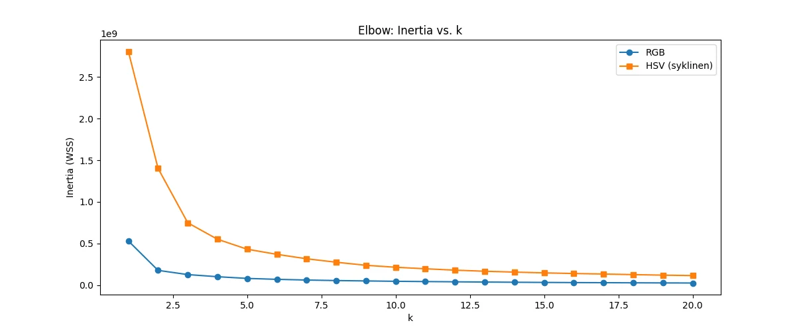
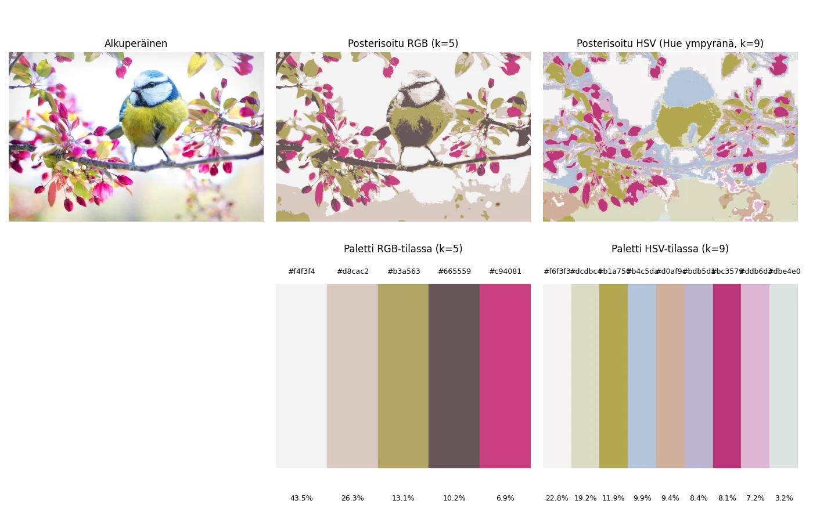
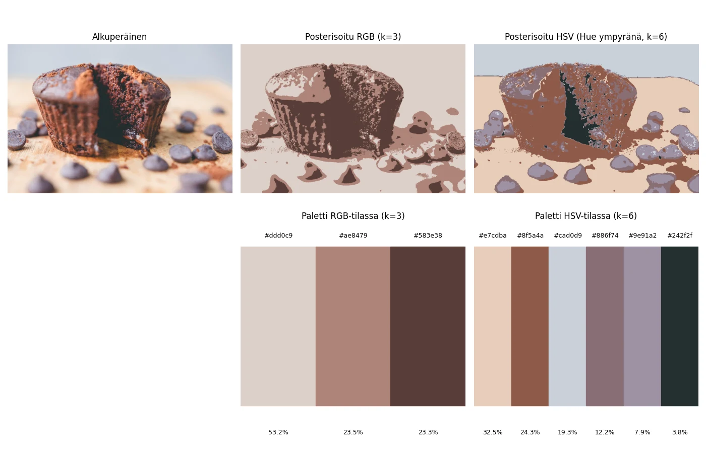
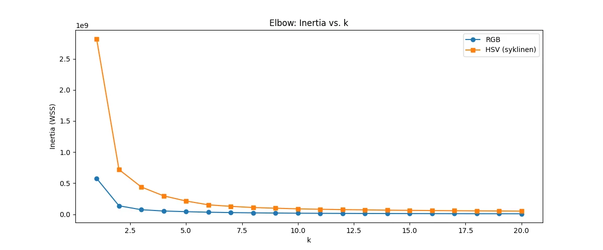

# Miten kuvasta syntyy toimiva väripaletti?

Lähdin tutustumaan ja vertailemaan RGB- ja HSV-värimalleja muutamilla eri kuvilla, joista kahden tuloksia esittelen tässä. Tavoitteena oli luoda skripti, joka palauttaa k-arvon mukaisen värikartan annetun kuvan perusteella.

## Pikseleistä värikartaksi

**k-Means** on klusterointialgoritmi eli ohjaamaton koneoppimismenetelmä, joka pyrkii ryhmittelemään havainnot siten, että saman klusterin jäsenet ovat mahdollisimman samanlaisia ja eri klusterit mahdollisimman erilaisia. Jokainen havainto lisätään siihen klusteriin, jonka keskipiste eli *centroid* on sitä lähimpänä. [^geeks]

Hyödynsin kuvien lukemiseen valmista Python-kirjastoa `OpenCV`. Jokainen pikseli käsiteltiin omana havaintonaan. Toteutin k-Means-algoritmin `scikit-learn`-kirjaston `sklearn.cluster`-moduulilla ja muodostin molemmista malleista posterisoidun kuvan sekä väripaletin. Väripaletit järjestettiin värien yleisyyden mukaan ja laskettiin niiden prosenttiosuudet.

## RGB vai HSV?

RGB koostuu kolmesta pääkanavasta: punaisesta, vihreästä ja sinisestä. Kaikki muut värit syntyvät yhdistämällä näitä kolmea pääväriä. [^geeks2]

HSV kuvaa väriä sävyn, kylläisyyden ja kirkkauden avulla: [^geeks2]

- **Hue (sävy)** kertoo itse värin, esimerkiksi punaisen tai vihreän. Sävy ilmaistaan kulmana värikehässä.
- **Saturation (kylläisyys)** kuvaa värin puhtautta. Arvo 0 tarkoittaa harmaata, ja mitä suurempi arvo, sitä voimakkaampi ja ”puhtaampi” väri on.
- **Value (kirkkaus)** kertoo, kuinka tumma tai vaalea väri on.

Tein kaksi klusterointia alkuun samalla klustereiden määrällä k: RGB-avaruudessa ja HSV-avaruudessa siten, että Hue enkoodattiin syklisesti koordinaatteina `(cos H, sin H)` ja kylläisyys sekä kirkkaus lisättiin piirteiksi `(S, V)`. Kokeilin myös painotuksia korostaakseni värisävyä suhteessa kirkkauteen.

Syklinen enkoodaus on tärkeä, koska sävy on kulma: OpenCV:n asteikolla arvot 0 ja 179 ovat molemmat punaista, vaikka ne ovat lukuina kaukana toisistaan. Kun sävy muutetaan kosiniksi ja siniksi, k-Means näkee nämä värit lähekkäin:

```python title="HSV-piirteet k-Meansille (ote omasta skriptistäni)"
hsv = cv2.cvtColor(img_rgb, cv2.COLOR_RGB2HSV).astype(np.float32)
H = hsv[..., 0] * (2 * np.pi / 180.0)   # OpenCV: H 0..179 → radiaaneiksi
S = hsv[..., 1] / 255.0
V = hsv[..., 2] / 255.0

# Sävy ympyrälle (cos, sin), kylläisyydelle oma painokerroin
X = np.stack([w_H * np.cos(H), w_H * np.sin(H), w_S * S, w_V * V], axis=-1).reshape(-1, 4)

km = KMeans(n_clusters=k, n_init=10, random_state=0)
labels = km.fit_predict(X)
```

Klusterikeskukset muunnetaan lopuksi takaisin HSV-arvoiksi `arctan2`-funktiolla, jotta niistä saadaan paletin värit.

## Kuinka monta väriä mukaan?

Myöhemmin lähdin etsimään molemmille malleille sopivaa k-arvoa elbow-menetelmällä.

Algoritmin tavoitteena on löytää klusterikeskukset, jotka minimoivat klusterien sisäisen hajonnan eli inertian. [^scikit] Kun klustereiden määrää k kasvatetaan, inertia pienenee, mutta jossain vaiheessa lisäklusterit eivät enää tuo merkittävää parannusta. Tätä voidaan esittää elbow-menetelmällä, josta sopiva k-arvo voidaan päätellä etsimällä niin sanottu ”olkapää”. [^vid1]

{ .evidence-image }

*Bird-kuvassa RGB:n inertia tasaantuu noin k=4–5 kohdalla, kun taas HSV:n inertia loivenee vielä k=7–9 asti. Siksi valitsin vertailuun RGB:lle k=5 ja HSV:lle k=9.*

Eri k-arvot eivät siis olleet mielivaltaisia. Valitsin klustereiden määrän kummallekin väriavaruudelle erikseen sen perusteella, missä elbow-käyrä alkoi tasaantua. Väriavaruudet kuvaavat samaa kuvaa eri tavoin, joten myös niiden käyrät saavuttavat hyödyllisen kompromissin eri kohdissa.

## Sama menetelmä, kaksi erilaista kuvaa

### Bird: tiivis paletti toimi paremmin

{ .evidence-image }

*Bird-kuvan värikartat ja posterisoidut kuvat. Tässä kuvassa on jo otettu käyttöön korkeampi k-arvo HSV-mallille.*

Bird-kuvassa RGB-malli yksinkertaistaa värit selkeämmin ja lopputulos näyttää realistisemmalta. HSV taas erottelee enemmän sävyjä, mutta kuvan vaaleus näyttäisi johtavan siihen, että se painottaa vaaleita alueita, minkä vuoksi linnun yksityiskohdat hukkuvat.

### Muffin: rikkaampi paletti toimi paremmin

{ .evidence-image }

*Muffin-kuvan värikartat ja posterisoidut kuvat.*

Tässä on nähtävissä, kuinka HSV-malli rajaa värit tarkemmin ja yksityiskohtaisemmin kuin RGB-malli. HSV-mallin tulos on vähemmän pehmeä, mutta informatiivisempi.

{ .evidence-image }

*Muffin-kuvassa RGB:n käyrä tasoittuu noin k=3–4 kohdalla ja HSV:n käyrä loivenee noin k=6–8 kohdalla. Siksi käytin esimerkissä RGB:lle k=3 ja HSV:lle k=6.*

## Mitä ”toimiva” tarkoittaa tässä?

Jos hakisimme Bird-kuvasta esimerkiksi sisustuksen väripalettia, yli yhdeksän sävyä voisi tuntua paljolta, joten näen RGB-mallin toimivan tälle kuvalle paremmin.

Muffin-kuvassa taas sisustuksen väripalettia ajatellen HSV-malli toimi paremmin ja siltä saisi rikkaamman väripaletin.

Käyttötarkoitus voi kuitenkin olla toinenkin kuin sisustus. Bird-kuvassa HSV voisi kertoa RGB:tä paremmin kuvan yleisestä luonteesta, koska se tuo vaaleuden ja sävyjen vaihtelun näkyväksi voimakkaammin. Tällöin HSV:n suurempi klusterimäärä ei ole huono asia, vaan se auttaa kuvaamaan juuri sitä piirrettä, jota haluamme tarkastella. Muffin-kuvassa HSV:n rikkaampi paletti puolestaan säilytti pieniä sävyeroja, jotka RGB tiivisti helpommin yhteen.

Näistä kokeiluista jäi itselleni käteen, ettei toimiva väripaletti tarkoita aina mahdollisimman montaa sävyä. Se syntyy väriavaruuden, elbow-menetelmällä valitun klusterimäärän ja käyttötarkoituksen yhteensovittamisesta. Sama kuva voi siis tarvita eri vastauksen sen mukaan, halutaanko siitä tiivis käyttöpaletti vai kuvan valoisuutta ja sävyvaihtelua kuvaava esitys.

---

!!! note "Kirjoituksen tausta"
    Kirjoitus on toimitettu Johdatus koneoppimiseen -oppimispäiväkirjani värikarttamerkinnästä. Kuvat esittävät siinä käsiteltyjen kokeilujen tuloksia. Koodikatkelma on lyhennetty ote omasta värikarttaskriptistäni. Kurssimateriaali: Jani Sourander. [^lmkurssi]

## Lähteet

[^geeks]: GeeksforGeeks. K-means clustering – Introduction. [Verkkolähde](https://www.geeksforgeeks.org/machine-learning/k-means-clustering-introduction/). 2025
[^geeks2]: GeeksforGeeks. Difference Between RGB, CMYK, HSV, and YIQ Color Models [Verkkolähde](https://www.geeksforgeeks.org/computer-graphics/difference-between-rgb-cmyk-hsv-and-yiq-color-models/). 2025
[^scikit]: Scikit-learn. Clustering. [Verkkolähde](https://scikit-learn.org/stable/modules/clustering.html)
[^vid1]: StatQuest with Josh Starmer. StatQuest: K-means clustering. YouTube. [Verkkolähde](https://www.youtube.com/watch?v=4b5d3muPQmA). 2018
[^lmkurssi]: Jani Sourander. Johdatus koneoppimiseen -verkkomateriaali. [Verkkolähde](https://sourander.github.io/ml-perusteet/)
