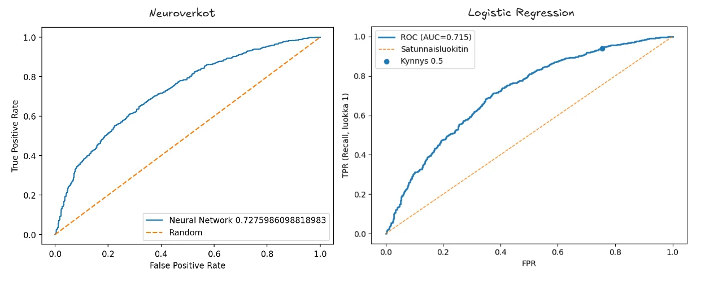
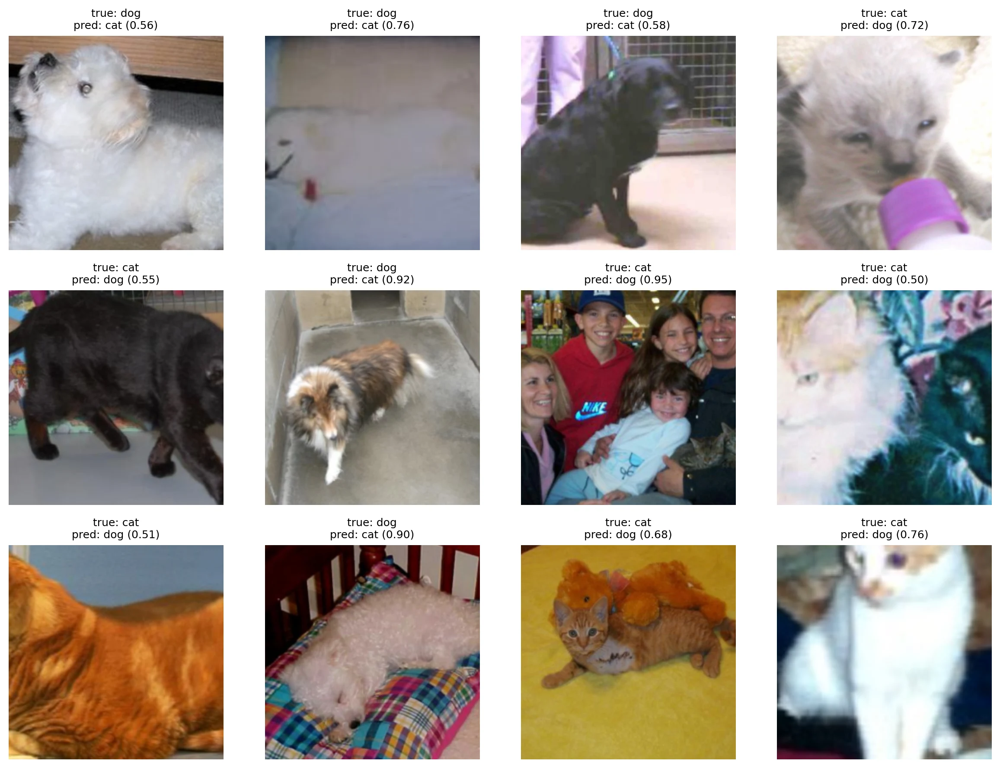

# Monimutkaisempi malli ei ole automaattisesti parempi

Syväoppimisen kurssilla sama havainto toistui kokeilusta toiseen: isompi, syvempi tai valmiiksi koulutettu malli ei aina tuonut odotettua etua. Välillä yksinkertainen malli ylsi lähes samaan, ja välillä vahvakin malli kompastui dataan. Kokosin tähän kokeiluni, joissa tämä tuli vastaan.

!!! abstract "Ydinhavainnot"
    Neuroverkot ja valmiit mallit eivät ole automaattinen "hopealuoti". Tulokset riippuvat pitkälti datasta, ja yksinkertaisempi malli kannattaa ottaa vertailukohdaksi ennen kuin siirtyy raskaampaan.

## Syvyys vai fiksut piirteet?

[TensorFlow Playgroundissa](https://playground.tensorflow.org/#activation=tanh&batchSize=10&dataset=circle&regDataset=reg-plane&learningRate=0.03&regularizationRate=0&noise=0&networkShape=4,2&seed=0.49199&showTestData=false&discretize=false&percTrainData=50&x=true&y=true&xTimesY=false&xSquared=false&ySquared=false&cosX=false&sinX=false&cosY=false&sinY=false&collectStats=false&problem=classification&initZero=false&hideText=false) huomasin konkreettisesti, että **0 piilokerrosta** vastaa käytännössä lineaarista mallia: XOR-data ei ole lineaarisesti eroteltavissa, joten malli ei pystynyt ratkaisemaan sitä. Kun lisäsin **yhden piilokerroksen**, XOR alkoi ratketa ja parannusta tuli erityisesti neuroneita lisäämällä. Näin jälkikäteen ajateltuna se tuntuu loogiselta: kerros ja epälineaarisuus mahdollistavat monimutkaisemmat yhdistelmät, mutta jos neuroneita on liian vähän, "rakennusmateriaalia" ei yksinkertaisesti riitä.

Kokeilin XOR:ää myös toista reittiä pitkin eli lisäämällä piirteitä itse (feature engineering). Kun piirteet annettiin "valmiimpina", myös yksinkertaisempi malli parani ja osasi ratkaista ongelman. Tämä korosti minulle eroa feature learningin ja feature engineeringin välillä: neuroverkko voi oppia hyödyllisiä piirteitä itse datasta, mutta joissain tapauksissa käsin rakennetut piirteet voivat vähentää tarvittavaa syvyyttä tai kapasiteetin tarvetta.

## Neuroverkko vai logistinen regressio?

Seuraavaksi sama kysymys tuli vastaan oikeammalla datalla. Kybervihan tunnistuksessa testasin neuroverkolle muutamia perusmuutoksia (piilokerrosten määrää, learning ratea, batch-kokoa sekä neuronien määrää per piilokerros). Sen lisäksi kokeilin pientä L2-regularisointia (`weight_decay=1e-4`), joka voi vähentää ylisovitusta. [^geeks_reg] Luokkien epätasapainoa voisi jatkossa myös huomioida luokkapainoituksilla [^geeks], mutta en lähtenyt virittämään sitä tässä vaiheessa enempää. 

{ .evidence-image }

*ROC-käyrät neuroverkolle ja logistiselle regressiolle kybervihan tunnistuksessa. Mitä lähempänä käyrä on vasenta yläkulmaa, sitä paremmin malli erottaa luokat eri kynnysarvoilla.*

Neuroverkko saavutti hieman korkeamman ROC AUC -arvon (0.728) kuin logistinen regressio (0.715), mutta ero jäi pieneksi. Tämä viittaisi siihen, että monimutkaisempi malli ei tuonut selkeää etua tässä tehtävässä vaan yksinkertaisempi malli ylsi lähes samaan erottelukykyyn. Havainto tukee ajatusta, että neuroverkot eivät ole automaattinen "hopealuoti" vaan tulokset riippuvat myös pitkälti datasta.

## Valmis kielimalli vai Naive Bayes?

Entä jos neuroverkkoa ei kouluta itse, vaan ottaa valmiin, suurella datalla koulutetun mallin? Vertasin aiemmin kouluttamaani `ComplementNB`-mallia valmiiseen `facebook/roberta-hate-speech-dynabench-r4-target`-malliin. Tulokset olivat hyvin lähellä toisiaan:

| Malli | Accuracy | F1 label: nothate | F1 label: hate |
|---|---|---|---|
| Naive Bayes ComplementNB | *0.91* | *0.94* | *0.82* |
| facebook/roberta-hate-speech-dynabench-r4-target | *0.90* | *0.93* | *0.82* |

Tässä asetelmassa tulos on looginen: tehtävä helpottui `offensive`-luokan poiston jälkeen, data oli epätasapainoinen, ja `ComplementNB` on suunniteltu toimimaan hyvin tällaisessa tilanteessa. [^scikit] Lisäksi NB oli sovitettu suoraan käyttämääni dataan, Davidsonin ym. Twitter-aineistoon. [^davidson] RoBERTa oli kyllä koulutettu vihapuheen tunnistukseen, mutta eri aineistolla. Testasin sitä samalla aineistolla sellaisenaan, ilman hienosäätöä, eikä se suoriutunut Naive Bayesia paremmin. Vihapuhe voi olla eri aineistoissa määritelty eri tavoin.

Vertailu ei ole aivan täsmälleen samoilla riveillä: Naive Bayes arvioitiin 20 %:n testijoukolla, kun taas RoBERTa ennusti koko aineiston, koska sitä ei koulutettu tällä datalla.

## Valmis kuvamalli ei tunne kaikkea

Kuvien puolella testasin esikoulutettua `MobileNetV3-Small`-mallia fossa-kuvalla (Cryptoprocta ferox). Vaikka oikea luokka löytyi ImageNetistä nimellä Madagascar cat (indeksi 383), se ei noussut tässä tapauksessa top-ennusteisiin.

{ .evidence-image }

*Fossa-testi: oikea luokka ei noussut top-ennusteisiin, mutta malli ehdotti petonisäkkäitä samankaltaisilla piirteillä (puuma, näätä, mangusti, minkki ja ilves).*

Tulos oli osittain looginen: malli ehdotti samantyyppisiä petonisäkkäitä, vaikka tarkka luokka jäi löytymättä. Tämä muistuttaa siitä, että top-1:n lisäksi kannattaa tarkastella myös top-k-tuloksia. Sama ilmiö toistui toisella kuvalla. Havainto vahvisti, ettei yleinen esikoulutettu malli välttämättä riitä fossa-lajin luotettavaan tunnistamiseen, vaan tarvitaan joko hienosäätöä kohdedatalla tai tehtävään paremmin sopiva malli. [^sour]

## Siirtovaikutus ei poista datan merkitystä

Valmista mallia voi myös sovittaa omaan tehtävään siirtovaikutuksella (transfer learning). Keräsin pienen oman webcam-datasetin `kivi|paperi|sakset` ja koulutin InceptionV3-mallia muuttamalla sen luokittelupään 1000 luokan sijaan 3 luokkaan.

```text title="InceptionV3 RPS-kokeen viimeinen epookki"
Epoch [6/6] Summary: Train Loss: 0.6606, Train Acc: 91.33% | Val Loss: 0.6622, Val Acc: 83.33%
```

Pienen datamäärän vuoksi tuli huomattua, että vaikka mallin oppiminen eteni hyvin, mukana oli myös ylisovituksen merkkejä. Vaikka siirtovaikutus vähentää datatarvetta, se ei poista datan laadun ja määrän merkitystä.

Sama näkyi, kun analysoin `DenseNet121`-mallin väärin luokiteltuja kuvia koira-kissa-tehtävässä. Mallin piirteitä erottavat kerrokset oli jäädytetty, ja vain luokittelupää oli koulutettu uudelleen. Huomasin, että virheitä syntyi erityisesti silloin, kun kohde oli pieni, kuva oli epäterävä tai rajattu huonosti tai tausta hallitsi näkymää.

{ .evidence-image }

*Väärin luokiteltuja testikuvia head-only-siirtovaikutusmallilta. Otsikoissa näkyvät true/pred-luokat ja mallin varmuus.*

Tämä oli hyvä muistutus siitä, ettei siirtovaikutus poista datan laadun merkitystä. Vaikka lähtömalli olisi vahva, huonolaatuinen tai hankala aineisto näkyy edelleen virheinä.

## Mitä tästä jäi käteen?

Pähkinänkuoressa opin, että isompi malli ei ole oikotie parempaan tulokseen. Yksinkertainen malli kannattaa ottaa vertailukohdaksi, koska se kertoo, paljonko monimutkaisempi malli oikeasti tuo lisää. Valmis malli taas säästää aikaa, mutta se ei välttämättä tunne juuri minun ongelmaani. Ja kaikissa kokeiluissa päädyin lopulta samaan asiaan: malli on vain niin hyvä kuin data, jolla se koulutetaan.

---

!!! note "Kirjoituksen tausta"
    Kirjoitus on koottu Syväoppiminen I -oppimispäiväkirjani merkinnöistä (neuroverkot, tensorit ja siirtovaikutus). Naive Bayes -malli on koulutettu aiemmin Johdatus koneoppimiseen -kurssilla. Kurssimateriaali: Jani Sourander. [^sour]

## Lähteet

[^sour]: Jani Sourander. [Syväoppiminen I -verkkomateriaali](https://sourander.github.io/syvaoppiminen/)
[^geeks_reg]: GeeksforGeeks. [Regularization in Machine Learning](https://www.geeksforgeeks.org/machine-learning/regularization-in-machine-learning/). 2025
[^geeks]: GeeksforGeeks. [Handling Class Imbalance in PyTorch](https://www.geeksforgeeks.org/deep-learning/handling-class-imbalance-in-pytorch/). 2025
[^davidson]: Thomas Davidson, Dana Warmsley, Michael Macy, Ingmar Weber. [Automated Hate Speech Detection and the Problem of Offensive Language](https://github.com/t-davidson/hate-speech-and-offensive-language). ICWSM. 2017
[^scikit]: Scikit-learn. [ComplementNB](https://scikit-learn.org/stable/modules/generated/sklearn.naive_bayes.ComplementNB.html)
