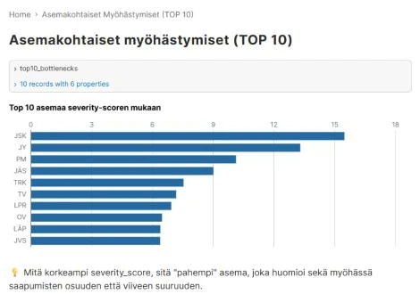
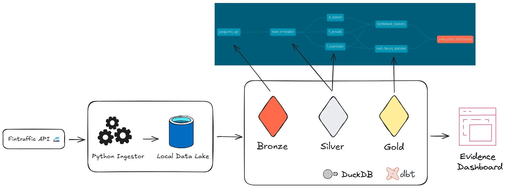
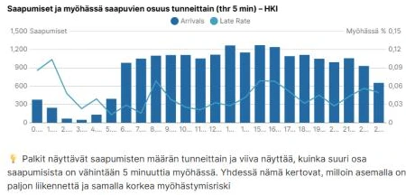

# JunaJumis – asemat, joissa aikataulu käy kahvilla

JunaJumis on Data-alustat-kurssin työ. Tehtävänä oli rakentaa dataputki Fintrafficin junadatasta ja analysoida sitä. Kurssi antoi projektirakenteen pohjaksi, mutta kysymyksen sain valita itse ja muokkasin rakenteen sen mukaan. Kysymykseni oli: **millä asemilla junat saapuvat useimmin myöhässä, ja mihin aikaan päivästä myöhästymiset kasautuvat?** Aineistona on lokakuu 2025.

{ .evidence-image }

*Evidence-dashboardin Top 10 -näkymä: asemat, joilla myöhästymiset olivat lokakuussa 2025 yleisimpiä ja pisimpiä. Asemat näkyvät lyhenteinään.*

**Pino:** Python, Fintraffic/Digitraffic API, dbt, DuckDB, Evidence, Docker, uv

[Koodi GitHubissa →](https://github.com/tuuturulla/train-delay-analytics){ .card-link }

## Putki

[{ .evidence-image .diagram-image }](../assets/junajumis-arkkitehtuuri.png)

*Putken arkkitehtuuri. Yläosan dbt-kaaviosta näkyy, mitkä taulut kuuluvat mihinkin kerrokseen. Avaa kuva isompana klikkaamalla.*

1. **Haku.** Python-skripti hakee jokaisen päivän junat rajapinnasta ja tallentaa vastauksen omaan kansioonsa. Pyyntöjen väliin jätetään tauko, jotta rajapinnan 60 pyynnön minuuttiraja ei ylity.
2. **Mallinnus.** dbt rakentaa datasta DuckDB-tietokantaan kolme kerrosta: raakadata tauluiksi (bronze), fakta- ja dimensiotaulut (silver) sekä valmiit mittarit (gold).
3. **Visualisointi.** Evidence lukee gold-kerroksen taulut ja näyttää ne dashboardina.

Koko ketju päivittyy yhdellä komennolla: `bash scripts/update_data.sh 2025-10-01 2025-10-31`.

## Miten "pahin asema" mitataan?

Pelkkä myöhästymisten osuus ei kerro koko totuutta: asema, jossa junat ovat usein minuutin myöhässä, on eri asia kuin asema, jossa ne ovat harvemmin mutta puoli tuntia myöhässä. Siksi yhdistin kaksi asiaa yhdeksi mittariksi:

- **Kuinka usein:** niiden saapumisten osuus, jotka olivat vähintään viisi minuuttia myöhässä.
- **Kuinka pahasti:** myöhässä olleiden junien viiveen 90. persentiili.

**Severity score** on näiden tulo. Mukaan otettiin vain asemat, joilla oli kuukaudessa vähintään 1 000 saapumista, jotta muutama myöhässä ollut juna pienellä asemalla ei nouse listan kärkeen.

## Mihin aikaan päivästä?

Toinen näkymä näyttää valitun aseman päivärytmin: kuinka paljon junia saapuu kunakin tuntina ja kuinka suuri osa niistä on myöhässä.

{ .evidence-image }

*Helsinki, lokakuu 2025. Pylväät näyttävät saapuvien junien määrän tunneittain ja viiva vähintään viisi minuuttia myöhässä saapuvien osuuden. Kellonajat ovat Suomen aikaa.*

Kuvasta näkee, että myöhästymisten osuus on korkeimmillaan yöllä noin kello yhden aikaan. Silloin junia on kuitenkin vähän: kello 1–2 Helsinkiin saapui koko kuukauden aikana 242 junaa, joista 25 oli myöhässä. Kun junia on vähän, jo muutama myöhästynyt juna nostaa osuutta paljon. Määrällisesti eniten myöhästyneitä junia saapui iltapäivän ruuhkassa kello 15–17 ja aamulla kello 8–9, jolloin liikennettä on paljon mutta osuus pysyy pienempänä. Osuus ja määrä kertovat siis eri asioita.

## Mitä tekisin toisin

**Kaaviot olisivat voineet olla selkeämpiä.** Asemat näkyvät dashboardissa lyhenteinä, kuten JSK tai JY, joita harva tunnistaa. Digitrafficin rajapinnasta saa myös asemien koko nimet, joten ne olisi voinut liittää asemadimensioon ja näyttää luettavina. Myös tuntikaavion akselilla kellonajat katkeavat, joten niistä joutuu arvaamaan, mikä pylväs on mikä tunti.

## Virheitä löytyy myös jälkikäteen

Kurssin jälkeen olen palannut projektiin kahdesti ja löytänyt molemmilla kerroilla virheen, joka oli jäänyt huomaamatta.

**Yhden päivän haku ei toiminut (helmikuu 2026).** Päivitysskriptille piti voida antaa joko yksi päivämäärä tai aikaväli. Jos loppupäivä puuttui, skripti välitti hakuohjelmalle tyhjän loppupäivän, ja haku kaatui virheeseen. Aikavälin kanssa skripti toimi, joten virhe paljastui vasta, kun käytin sitä toisella tavalla. Korjasin skriptin käyttämään alkupäivää myös loppupäivänä, kun loppupäivää ei anneta.

**Kellonajat olivat UTC-aikaa (marraskuu 2026).** Rajapinta antaa ajat UTC-aikana, ja tunnit laskettiin niistä suoraan. Siksi tuntinäkymä oli 2–3 tuntia jäljessä Suomen ajasta. Huomasin virheen, kun Helsingin vilkas liikenne näytti alkavan jo kolmelta aamulla, vaikka ensimmäiset junat saapuvat vasta aamuviiden jälkeen. Korjasin dbt-mallin muuntamaan ajat Suomen aikaan ennen tuntien laskemista. Muunnos huomioi myös kesäajan päättymisen lokakuun lopussa.

Virheet olivat erilaisia. Ensimmäinen näkyi heti, kun skriptiä käytti uudella tavalla. Toinen ei antanut mitään virheilmoitusta: putki toimi, mutta tulos oli väärin. Virhe meni läpi myös kurssin arvioinnissa, mikä kertoo, kuinka helposti tällainen jää huomaamatta. Se löytyi vain vertaamalla tulosta siihen, mitä tiesin todellisuudesta. Molemmat muistuttavat, että valmiiksi merkittyynkin työhön kannattaa palata.

## Mihin tästä voisi jatkaa?

Nämä jatkosuunnat olivat mukana jo kurssin loppuesityksessäni:

- **Seurannasta syiden etsintään.** Asemakohtainen mittari näyttää, minne junat saapuvat myöhässä, mutta viive on voinut syntyä jo paljon aiemmin reitillä. Seuraava askel olisi laskea junakohtaisesti, kuinka paljon viive kasvaa kahden peräkkäisen aseman välillä. Data mahdollistaisi tämän, koska jokaisen junan aikataulurivit sisältävät toteutuneet ajat jokaisella asemalla. Jos viive kasvaa toistuvasti samalla välillä, se voisi kertoa jotain itse radasta, kuten yksiraiteisuudesta, radan kunnosta tai ruuhkasta.
- **Datan rikastaminen.** Lisädatalla, kuten tarkemmilla asematiedoilla tai rataosuuksien tiedoilla, analyysin voisi yhdistää radan ominaisuuksiin. Silloin asemavälien vertailusta näkisi esimerkiksi, ovatko viiveet yleisempiä yksiraiteisilla osuuksilla.

---

!!! note "Projektin tausta"
    Data-alustat-kurssin työ, syksy 2025. Kurssi antoi projektirakenteen; kysymys, dbt-mallit, mittarit ja dashboardin toteutin silti itse.
