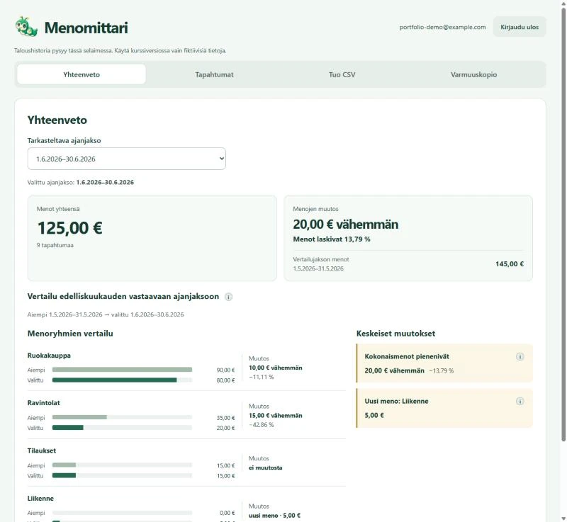

# Menomittari – mihin rahat menevät?

Menomittari on oma ideani: selainsovellus, johon tuodaan tilitapahtumat CSV-tiedostona. Sovellus ryhmittelee menot ja vertaa kahta ajanjaksoa: mihin rahat menivät ja mikä omassa kulutuksessa muuttui? Tein sen Web-ohjelmoinnin kurssin lopputyönä elo–lokakuussa 2026. Halusin toteuttaa sen niin, että sen pohjalta voisi lähteä rakentamaan oikeaa tuotetta.

{ .evidence-image }

*Yhteenveto vertaa kesäkuuta toukokuun vastaavaan jaksoon: menot yhteensä, muutos menoryhmittäin ja enintään kolme sääntöpohjaista havaintoa. Aineisto on keksittyä.*

**Pino:** React, TypeScript, FastAPI, SQLite, IndexedDB, Docker · **Testaus:** Vitest, pytest ja käsin tehty käyttötesti · **Laajuus:** 9 vaihetta, 57 committia

[Koodi ja tekninen dokumentaatio GitHubissa →](https://github.com/tuuturulla/menomittari-spending-tracker){ .card-link }

## Minun roolini ja agentin rooli

Koodin kirjoitti pääosin koodausagentti. Minä suunnittelin agentin kanssa, mitä tehdään ja miksi, ja kirjasimme suunnitelmat dokumenteiksi ennen toteutusta. Kirjoitin agentille työohjeen: jokainen vaihe omalla haarallaan, ei muutoksia päähaaraan ilman minua ja vain keksittyä aineistoa. Agentti kirjoitti jokaisesta vaiheesta työselosteen valinnoista ja perusteluista, ja kävin ne läpi. Mikään vaihe ei ollut valmis ennen kuin olin testannut sen itse.

## Kolme päätöstä

**Talousdata pysyy selaimessa.** Tilitapahtumat tallennetaan vain käyttäjän omaan selaimeen. Oikeiden tilitietojen vastaanottaminen palvelimelle kasvattaisi vastuuta huomattavasti.

Kurssityö ei olisi vaatinut backendia tai kirjautumista lainkaan. Tuotteenakaan sovellus ei välttämättä tarvitsisi niitä: jos sen voisi ostaa kertamaksulla kuten vaikka pelin. Maksulliset lisäominaisuudet tai synkronointi taas vaatisivat ne. Lisäsin kirjautumisen jo nyt, koska halusin ratkaista, miten tilit toteutetaan niin, että palvelimelle päätyvät vain kirjautumistiedot eikä mitään talousdataa.

**Tiukka MVP-rajaus.** Kirjasin joka alueelta, mitä tehdään nyt ja mitä jätetään tietoisesti pois. Rajaus piti työn hallittavana ja teki näkyväksi, mitä tuotetavoitteista ei vielä ole saavutettu.

**Laskenta erillään tallennuksesta.** Laskentasäännöt eivät riipu käyttöliittymästä tai tietokannasta. Ne voi testata erikseen, eikä tallennustavan vaihtaminen myöhemmin vaadi niiden uudelleenkirjoittamista. Tämä on tärkeää, jos projektista halutaan kasvattaa tuote.

## Mitä opin agentin kanssa työskentelystä

Tämä oli ensimmäinen kerta, kun tein kokonaisen projektin agentin kanssa.

**Ihmistä tarvitaan käyttöliittymän arviointiin.** Testasin toiminnot itse: toin CSV-tiedostoja, tarkistin summat ja kokeilin tahallaan virheellisiä tuonteja. Eniten korjattavaa löytyi käyttöliittymästä. Agentti pystyy tarkistamaan toiminnallisuuden testeillä ja kuvakaappauksilla, mutta kuvakaappaus näyttää yleensä vain yhden kohdan kerrallaan. Kuvasarjoja voisi ottaa enemmänkin, mutta se maksaa ja vie aikaa. Eikä agentti silti voi tietää, onko jokin mukava käyttää, ennen kuin oikea ihminen kokeilee.

**Tuntuma koodiin katoaa helposti.** Agentti tuottaa koodia nopeasti ja paljon. Opiskelijana minun oli vaikea pysyä mukana, varsinkin kun React ja TypeScript olivat minulle uusia. Kun uusia asioita on monta yhtä aikaa, on vaikea päästä jäljille siitä, mitä koodi oikeasti tekee. Työselosteet auttoivat, mutta oppimisen kannalta tämä ei ollut paras tapa.

Tärkein oppi oli, että kannattaa edetä pienissä osissa. Muutaman funktion logiikan jaksaa vielä käydä huolella läpi. Jos agentti tuottaa kerralla tuhat riviä koodia, rehellinen vastaus kysymykseen "luitko kaiken?" on harvoin kyllä. Pienemmät palat pitävät ihmisen oikeasti mukana silmukassa.

## Mitä seuraavaksi

Nykyinen versio on yksinkertainen sääntöpohjainen prototyyppi. Tuonti tukee vain demomuotoa ja S-Pankin CSV:tä, ja luokittelu perustuu neljään kiinteään kauppiassääntöön. Seuraavaksi kiinnostaisivat parempi kauppiastunnistus, toistuvien kulujen kuten tilausten löytäminen sekä koko vuoden rahankäytön yleiskuva.

**Avoin kysymys: mitä tapahtuu, kun selainhistoria tyhjennetään?** Nyt talousdata säilyy vain varmuuskopiotiedoston avulla, ja tuotteessa tarvittaisiin jotain parempaa. Salattu synkronointi laitteiden välillä pitäisi lupauksen, ettei palvelin näe talousdataa, mutta se on vaativampi toteuttaa. Pilvitallennus olisi yksinkertaisempi, mutta se riitelisi local first -periaatteen ja koko palvelun lupauksen kanssa. Synkronointi voisi olla palvelun maksullinen osa.

**Oppiminen omasta historiasta voi tapahtua selaimessa.** Pidemmällä aikavälillä Menomittari voisi huomata käyttäjän omassa historiassa käytösmuutoksia, poikkeavia kuukausia tai hinnannousuja. Yhden ihmisen historia on niin pieni, että laskenta tai kevyt koneoppimismalli toimii hyvin selaimessa, joten mitään ei tarvitse lähettää palvelimelle. Sovelluksen tehtävä on silti näyttää, mikä muuttui, eikä arvioida, mikä ostos oli tarpeeton.

**Tekoäly vain rajatusti.** Luokittelua voisi täydentää tekoälyllä, ja senkin olen jo rajannut:

- Ensisijaisesti tapahtuma tunnistetaan paikallisesti kauppiastietokannan avulla.
- Tekoälyä käytetään vain niihin tapahtumiin, joita tietokanta ei tunnista.
- Käyttäjä päättää itse, lähetetäänkö tieto tekoälylle. Oletuksena mitään ei lähetetä.
- Tekoälylle lähtee tasan se yksi tunnistamaton rivi, ei koko tapahtumahistoriaa.

Näin tekoäly paikkaa sääntöjen aukkoja, mutta talousdata pysyy edelleen pääosin käyttäjän omassa selaimessa.
